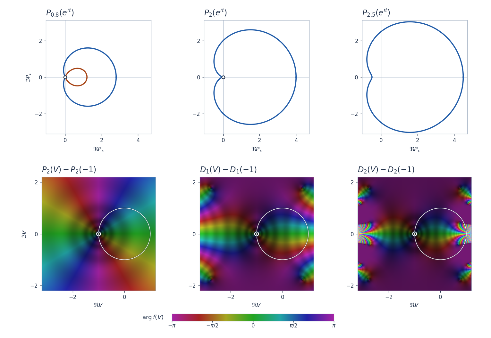

# 有限层指数多项式的零点与分解

**研究笔记 · 2026-11-17**

8 月 16 日的讨论把有限和 $\sum_i c_i e^{g_i}$ 作为原生函数论中的类多项式候选。这里从生成运算和有序历史出发，在基本 AES 上定义一个解析函数代数，再取乘法坐标的单变量复化来考察零点。苑明理提出问题、选取分圆多项式并用可视化追问乘积结构。Codex（OpenAI）协助核对记号、推导、图像与文献。

生成规则和历史解释是工作定义。下文的复分析结论适用于由 $\mathbb C[V]$ 经有限次 $+,\cdot,\exp$ 生成的一元整函数。图中重数和局部变化有相应的解析推导。

## 1. 基本 AES 上的生成规则

在 Paper 0 的基本模型 $\mathfrak E_0$ 上取 $a=-x/y$、$V=-\log y$，固定正强度 $\mu,\lambda$。接触模型的 Reeb 商和规范标架在这些坐标中给出

$$
Q(u,v,a)=(-ae^{-\lambda v},e^{-\lambda v}),\qquad Q^*V=\lambda v,
$$

$$
X_u=\mu\partial_a,\qquad X_v=\lambda(\partial_V+a\partial_a),
\qquad [X_u,X_v]=\lambda X_u .
$$

这里 $D_u,D_v$ 是接触模型上的水平向量场，$Q_*D_u=X_u$、$Q_*D_v=X_v$。等价地，对标量函数 $f$ 有 $D_u(Q^*f)=Q^*(X_uf)$、$D_v(Q^*f)=Q^*(X_vf)$。Reeb 商忘掉 $u$，ACS 的荷投影忘掉 $a$。这两个投影保留的信息不同。 [Paper 0 的规范标架](../../paper-0/sections/03-aes-and-motion.tex#L149-L201) · [Reeb 商与荷投影](../../paper-0/sections/09-contact-of-tearing.tex#L488-L635)

Paper 0 用 $(A,M)$ 表示 ACS 的加法荷与对数乘法荷。它在一维赋值线的 Lie 闭包命题里也用过 $A=\partial_a$、$M=a\partial_a$。process-geometry 的二维 A/M 标架有额外的乘法坐标方向，即 $A=\mu^{-1}X_u$、$M=\lambda^{-1}X_v$。Paper I 的 $A_h,M_k$ 表示时间参数为 $h,k$ 的有限赋值运算。以下使用 $X_u,X_v$ 并以 $j$ 记指数层数。 [Paper 0 的一维命题与二维校准](../../paper-0/sections/10-beyond-linear.tex#L13-L45) · [Paper 0 的二维校准](../../paper-0/sections/10-beyond-linear.tex#L237-L268) · [Paper I 的有限赋值运算](../../paper-1/sections/04-differential-theory.tex#L9-L47) · [process-geometry 的 A/M 标架](https://github.com/mountain/process-geometry/blob/c47c96fa79123c677172278be59d67ca1cc891b1/docs/06-addition-multiplication-function-theory.md#3-infinitesimal-am-frame)

在连通开图上，取一个含幺实解析函数代数 $\mathcal R_0$，并要求 $X_u,X_v$ 保持它。首个起点为 $\mathbb R[a,V]$，在 $a>0$ 的图上也可取 $\mathbb R[a,a^{-1},V]$。递归定义

$$
\mathcal R_{j+1}
=\left\{\sum_{i=1}^{N}c_i e^{g_i}\ \middle|\ N\ge 0,\quad
c_i,g_i\in\mathcal R_j\right\},
\qquad
\mathcal R_{\mathrm{fin}}=\bigcup_{j\ge 0}\mathcal R_j .
$$

空和表示零。等式按图上的实际函数相等来理解。$e^0=1$ 给出 $\mathcal R_j\subseteq\mathcal R_{j+1}$，$e^g e^h=e^{g+h}$ 给出乘法闭合。链式法则

$$
X(c e^g)=(Xc+c\,Xg)e^g,\qquad X\in\{X_u,X_v\}
$$

逐层给出两个方向下的闭合性。指数层数记录一种生成复杂度。将迭代对象化为新运算及给出降阶语义，属于进一步的过程构造。 [process-geometry 的对象化与降阶](https://github.com/mountain/process-geometry/blob/c47c96fa79123c677172278be59d67ca1cc891b1/docs/44-objectification-semantic-compression-and-rank-lowering.md)

### A/M 基本族

对常数 $b$，在连通图上有

$$
X_u g=0,\quad X_v g=\lambda b
\quad\Longleftrightarrow\quad
g=bV+\text{常数}.
$$

因为两个标架方向都消去 $g-bV$，其微分为零。$g=V$ 给出 $X_u g=0$、$X_v g=\lambda$。这里的「一次」是指数关于 $V$ 为仿射函数。乘上赋值的幂得到

$$
\begin{aligned}
X_u(a^n e^{bV})&=\mu n a^{n-1}e^{bV},\\
X_v(a^n e^{bV})&=\lambda(n+b)a^n e^{bV}.
\end{aligned}
$$

当 $n=0$ 时，第一式读作零。$n$ 在多项式起点取非负整数，在 Laurent 起点可取任意整数。令 $\nu=n$、$w=n+b$，便得到 process-geometry 的 $\Phi_{\nu,w}=a^\nu e^{(w-\nu)V}$，乘法把 $(\nu,w)$ 相加。这族的有限和属于第 1 层，对应只让 $g_i=b_i V$、只让 $c_i$ 依赖于 $a$。不同 $b_i$ 项的系数唯一，固定 $a$ 后对 $V$ 取各阶导数即可用 Vandermonde 矩阵分离。若 $w\in\mathbb Z$，Paper I 的整数等级联络消去 $Q^*(a^n e^{bV})$ 的乘法分量，且 $e^{-wV}a^n e^{bV}=(-x)^n$。 [幂—权重族](https://github.com/mountain/process-geometry/blob/c47c96fa79123c677172278be59d67ca1cc891b1/docs/06-addition-multiplication-function-theory.md#4-power-weight-lattice) · [Paper I 的分次水平微分](../../paper-1/sections/04-differential-theory.tex#L123-L168)

$e^a$ 在第 1 层。固定 $V$ 后，它的增长就把它与有限的 $a$-Laurent 多项式区别开来。它的 Taylor 展开却涉及所有非负整数幂。类似地，$e^{e^a-1}$ 超过第 1 层沿 $a\to+\infty$ 的任一有限多项式指数增长界，但可以在 $\mathbb R[[a]]$ 中逐系数展开。若将幂—权重展开搬到形式代数里，一个可用的充分条件是非常数支撑落在离散格的有理多面锥内，并有对非零方向严格为正的线性高度。Laurent 例子 $e^{a+a^{-1}}$ 在 $a>0$ 解析，它的形式常数系数却同时收到每个 $k\ge0$ 的 $1/(k!)^2$ 贡献，超出了该逐系数有限性条件。 [process-geometry 的完成锥定理](https://github.com/mountain/process-geometry/blob/c47c96fa79123c677172278be59d67ca1cc891b1/sonnet/am-completion-cones/01-initial-cone-theorems.md#3-completed-exp-and-log)

## 2. 一元复化与程序回拉

以下只考察乘法坐标 $V$，把它视为整复平面的变量。记 $R_0=\mathbb C[V]$，沿用上面的递归得到 $R_j$ 与 $R_{\mathrm{fin}}$。在这一元模型中，$X_u f=0$、$X_v f=\lambda f'$。若 $r$ 是 $f$ 的 $m$ 重根，$X_v f$ 在 $r$ 的消失阶为 $m-1$。沿乘法流的标量回拉为 $f(V+\lambda t)$，所以根的位置由 $r$ 移到 $r-\lambda t$，重数保持。

给定一个程序 $D$，记 $\overline D$ 为它在选定坐标中的值映射。对可接续的历史 $\gamma$，$D_*\gamma$ 表示把该次执行接在 $\gamma$ 后面。对目标坐标中的标量探针 $\varphi$，取 $D^*\varphi=\varphi\circ\overline D$。记 $\operatorname{ev}(\gamma,\varphi)=\varphi(\operatorname{end}\gamma)$，则有

$$
\operatorname{ev}(D_*\gamma,\varphi)=\operatorname{ev}(\gamma,D^*\varphi),\qquad
(E\circ D)_*=E_*\circ D_*,\qquad (E\circ D)^*=D^*\circ E^* .
$$

前两个等式来自执行的端点与接续，最后一个来自函数复合。这个约定把有序历史与端点上的函数求值联系起来。Adva 研究 0018 在有限因果切口上处理的是微分探针，指数事件的局部反向系数为 $Qe^A$。那里保留未化简的生成式。选定有限端口坐标后，微分探针的作用也可以写成矩阵。 [Adva 0018](https://github.com/mountain/adva/blob/8fc38427f2a479b4e8e84802e1873cff14d54566/docs/research/0018-exponential-symbolic-cut-composition.md)

### 四个最小例子

$m=1,2$ 表示起始多项式 $V^m$ 的次数。用输出探针 $w-1$，根由 $D(V)=1$ 给出。

| 起始次数 | 指数层数 | $D(V)$ | $D^*(w-1)$ 的根 |
| --- | --- | --- | --- |
| 1 | 1 | $e^V$ | $V=2\pi i k$ |
| 2 | 1 | $e^{V^2}$ | $V^2=2\pi i k$ |
| 1 | 2 | $\exp(e^V-1)$ | $V=\operatorname{Log}(1+2\pi i k)+2\pi i\ell$ |
| 2 | 2 | $\exp(e^{V^2}-1)$ | $V^2=\operatorname{Log}(1+2\pi i k)+2\pi i\ell$ |

$k,\ell$ 遍历整数，$\operatorname{Log}$ 取主值。对 $m=1$，各根都是简单根。对 $m=2$，零地址给出 $V=0$ 的二重根，其余根都是简单根。两层的极小性也可直接检查。一层项无零点且非常数，因而不能是多项式。二层项在正实轴上的增长超过 $R_1$ 中每个元素的多项式指数增长界。

一般地，若探针在 $w_0$ 的零点重数为 $d$，且 $D-w_0$ 在 $r$ 的消失阶为 $e$，回拉后的重数是 $de$。这是把局部因子 $(w-w_0)^d$ 代入 $D$ 得到的。分圆探针 $\Phi_4(w)=w^2+1$ 因而对应 $D(V)=i$ 与 $D(V)=-i$ 两束根。一层时可直接解 $V^m=i(\pm\pi/2+2\pi k)$，二层时在这一地址上再解 $e^{V^m}=1+i(\pm\pi/2+2\pi k)$。

## 3. 单位圆、一次项扰动和指数像

设 $V=e^{it}$。$\Phi_4(V)=V^2+1=1+e^{2it}$ 把单位圆送到圆心为 $1$、半径为 $1$ 的圆，参数绕两遍。以 $V$ 为底的一层和二层例子在单位圆上各走一遍简单闭曲线。第一层的输入满足 $\lvert\Im V\rvert\le1$，第二层的输入满足 $\lvert\Im(e^V-1)\rvert\le e<\pi$，两次指数在各自的输入范围内均单射。以 $V^2$ 为底的两个例子沿同样的曲线各走两遍，并在 $V$ 与 $-V$ 处重合。关于某个输出值的绕数需另行指定该值。

加入实系数的一次项，令

$$
q_\epsilon(V)=V^2+\epsilon V,\quad
P_\epsilon=1+q_\epsilon,\quad
D_1=e^{q_\epsilon},\quad D_2=\exp(D_1-1).
$$

对单位圆，

$$
P_\epsilon(e^{it})=e^{it}(2\cos t+\epsilon),\qquad
P_\epsilon(V)-P_\epsilon(W)=(V-W)(V+W+\epsilon).
$$

由于 $P_{-\epsilon}(V)=P_\epsilon(-V)$，取 $\epsilon\ge0$ 即可。根为

$$
r_\pm=\frac{-\epsilon\pm\sqrt{\epsilon^2-4}}{2},\qquad r_+r_-=1.
$$

| $\epsilon$ | $P_\epsilon$ 的根 | 单位圆在 $P_\epsilon$ 下的像 |
| --- | --- | --- |
| $0$ | $\pm i$ | 同一圆走两遍 |
| $0<\epsilon<2$ | 单位圆上的两个共轭简单根 | 在原点有一个横截自交，形成两个环 |
| $\epsilon=2$ | $-1$ 是二重根 | 原点处有一个尖点 |
| $\epsilon>2$ | 两个实负简单根，圆内、圆外各一 | 光滑简单闭曲线 |

对 $0<\epsilon<2$，不同圆周点同像要求 $V+W=-\epsilon$。这一非零实和确定了唯一一对共轭点。它们是 $r_\pm$，两处的切向分别与 $r_\pm$ 实平行，彼此横截。$\epsilon=2$ 时令 $V=-e^{it}$，有 $P_2(V)=(1-e^{it})^2=-t^2-it^3+O(t^4)$，得到尖点。$\epsilon>2$ 时两圆周点之和的模至多为 $2$，且 $P_\epsilon'$ 在圆周上也处处非零。

三种函数的临界输入都是 $V_c=-\epsilon/2$，因为

$$
P_\epsilon'=2V+\epsilon,\qquad D_1'=D_1(2V+\epsilon),\qquad
D_2'=D_2D_1(2V+\epsilon).
$$

外层指数在有限点处导数非零，故从 $P_\epsilon$ 的临界值到两层指数的对应临界值，局部是全纯坐标变换。临界点在 $\epsilon=2$ 通过单位圆，相应的尖点仍在两层指数像上出现。对 $0<\epsilon<2$，两个 $P_\epsilon$ 根在两层中分别同像于 $e^{-1}$ 和 $\exp(e^{-1}-1)$，继承的横截自交也保持。

### 周期性带来的其他重合

一层的同像条件是 $q_\epsilon(V)-q_\epsilon(W)\in2\pi i\mathbb Z$。二层的条件是 $D_1(V)-D_1(W)\in2\pi i\mathbb Z$。对 $0\le\epsilon\le2$，圆周上 $\lvert\Im q_\epsilon\rvert\le1+\epsilon<\pi$，所以一层在此范围只继承 $q_\epsilon$ 的重合。二层的额外重合可以早于 $\epsilon=2$。例如 $\epsilon=1$ 时，$t=0$ 处 $\Im D_1(e^{it})=0$，$t=\pi/6$ 处它等于 $e^b\sin b>\pi$，其中 $b=(1+\sqrt3)/2$。中间某处 $\Im D_1(e^{it})=\pi$，此处与共轭输入经 $D_2$ 得到同一值。这说明 $\epsilon=2$ 的共同转折发生在继承的临界分支上，二层还需另计周期造成的自交。

## 4. 域着色读出的零点和重数

域着色给每个输入 $V$ 按 $\arg f(V)$ 配色，明暗可随 $\lvert f(V)\rvert$ 变化。对正向简单闭曲线 $\Gamma$，若 $f$ 在曲线上无零点且在曲线及其内部的邻域全纯，辐角原理给出

$$
\operatorname{wind}\bigl(f(\Gamma),0\bigr)
=\frac{1}{2\pi i}\int_\Gamma \frac{f'(V)}{f(V)}\,dV .
$$

右侧是曲线内按重数计的零点数。围一个简单根的小圈转一圈，围一个二重根转两圈。若 $\Gamma$ 穿过零点，关于 $0$ 的绕数未定义。对 $P_\epsilon$，取单位圆时 $\epsilon\in[0,2]$ 正遇到这种情形，$\epsilon>2$ 时绕数为 $1$。 [域着色的示例与配色](https://en.wikipedia.org/wiki/Domain_coloring)

上排取 $\epsilon=0.8,2,2.5$ 并用同一输出尺度。下排固定 $\epsilon=2$，在 $\Re V\in[-3.2,1.2]$、$\Im V\in[-2.2,2.2]$ 的同一输入窗口给三种减过临界值的函数着色。白线是单位圆，白色空心点标记 $V_c=-1$。色相随辐角完整循环，明暗随对数模长变化，变化快于像素分辨率的区域降低色彩饱和度。额外的零点由下面的地址式给出。

$D_1,D_2$ 本身处处非零。为直接观察临界点处的重数，对每个函数减去各自的临界值。设 $s=(V-V_c)^2$、$B=D_1(V_c)=e^{-\epsilon^2/4}$，则

$$
\begin{aligned}
P_\epsilon(V)-P_\epsilon(V_c)&=s,\\
D_1(V)-D_1(V_c)&=B(e^s-1),\\
D_2(V)-D_2(V_c)&=D_2(V_c)\bigl(\exp(D_1(V)-D_1(V_c))-1\bigr).
\end{aligned}
$$

| 减去临界值后的函数 | 零点地址 |
| --- | --- |
| $P_\epsilon-P_\epsilon(V_c)$ | $s=0$ |
| $D_1-D_1(V_c)$ | $s=2\pi i k$ |
| $D_2-D_2(V_c)$ | $s=\operatorname{Log}(1+2\pi i k/B)+2\pi i\ell$ |

两层的地址中 $k,\ell$ 均为整数。零地址给出同一二重根 $V_c$，其余地址给出两个简单根。局部绕色只数所选小圈内的根。乘上另一个函数时，两者的局部消失阶相加，这也是图上能直接读出的乘法规律。

## 5. 指数展开与有限零点定理

**唯一展开。** 对 $j\ge1$，任一 $f\in R_j$ 有唯一的有限展开

$$
f(V)=\sum_g p_g(V)e^{g(V)},\qquad
p_g\in\mathbb C[V],\quad g\in R_{j-1},\quad g(0)=0 ,
$$

其中同一 $g$ 合并，只列非零系数。存在性来自逐层展开系数项。相乘的指数合并相加，常数指数可吸收入多项式系数。不同的归一化指数之差是非常数整函数。Narasimhan 的定理 1 表明，它们的指数函数在 $\mathbb C[V]$ 上线性无关，因而展开唯一。 [Narasimhan (1971)，原文](https://www.numdam.org/item/AIF_1971__21_3_271_0/)

**有限零点分解。** 若非零 $f\in R_j$ 只有有限个零点 $r_1,\ldots,r_\ell$，重数为 $m_1,\ldots,m_\ell$，则

$$
f(V)=e^{g(V)}\prod_{\nu=1}^{\ell}(V-r_\nu)^{m_\nu},
\qquad g\in R_{j-1}\quad (j\ge1).
$$

令 $p$ 为右侧的首一多项式部分。$f/p$ 延拓为无零点整函数，因 $\mathbb C$ 单连通而有整对数 $H$。比较 $f=pe^H$ 与唯一展开。对 $H-H(0)$ 及展开中原有的归一化指数应用同一个线性无关定理，可知唯一非零项的指数是 $H-H(0)$。于是 $H\in R_{j-1}$，可取 $g=H$。反向由 $e^g$ 无零点直接得到。$j=0$ 时就是普通的一元多项式分解。

因此一个非零元素只有有限个零点，当且仅当它在归一化展开中只有一个非零项。两个或更多不同的指数项必产生无穷多个零点。零点集为空时 $p=1$，而 $e^{-g}$ 是 $e^g$ 在类内的逆。于是 $R_{\mathrm{fin}}$ 的每个非零非单位元都有复根。这保留了代数基本定理的根存在性，并在有限零点的情形保留了逐根分解。

**逐根整除的边界。** 由展开唯一性可知，$V-r$ 在 $R_{\mathrm{fin}}$ 中整除 $f$，当且仅当每个 $p_g(r)$ 都为零。取值条件 $f(r)=0$ 允许各指数项的值相消。例如 $e^V-1$ 在 $0$ 有根，且 $(e^V-1)/V$ 可整延拓。展开式的两个系数为 $1$ 和 $-1$，所以这个商在任何有限层都不存在。

## 6. 固定指数坐标后的乘积分解

取归一化指数的加法群中一个有限生成子群 $L$。它无挠，故有整数基 $g_1,\ldots,g_d$。只允许指数取自 $L$，且系数在 $\mathbb C[V]$，在 $X_i=e^{g_i(V)}$ 下得到同构

$$
\mathbb C[V,X_1^{\pm1},\ldots,X_d^{\pm1}]
\ \longrightarrow\
\left\{\sum_{g\in L}p_g(V)e^{g(V)}\ \middle|\,
p_g\in\mathbb C[V],\ \text{只有有限个非零项}\right\}.
$$

乘法相容来自 $e^g e^h=e^{g+h}$，单射来自唯一展开。左侧是 Laurent 多项式环，因此在固定的 $L$ 内可作通常的唯一因子分解，允许重排和乘以单位元。若用 $U(V,X)$ 表示一个 Laurent 多项式因子，回到输入平面时，它的零点沿曲线

$$
V\longmapsto (V,e^{g_1(V)},\ldots,e^{g_d(V)})
$$

读取。一个因子可以给出许多根。

最直接的例子是 $P(e^g)$，其中 $P$ 是常系数一元多项式。对 $P(X)$ 作普通分解，得到 $C\prod_\alpha(e^g-\alpha)^{m_\alpha}$。对 $\alpha\ne0$，因子 $e^g-\alpha$ 把 $g(V)=\log\alpha+2\pi i k$ 的整束原像收在一起。$\alpha=0$ 的部分并入单位元。在上节的临界值探针中，$X-1$ 是值坐标 $X=e^{(V-V_c)^2}$ 中的一次因子。它的回拉同时给出中心的二重根及周期地址上的简单根。两层时，外层的一个一次因子先给出中间值平面上的一束目标值，再逐个拉回输入平面。

扩大允许的指数群会改变因子的可约性。对任意整数 $n\ge1$，

$$
e^V-1=\prod_{k=0}^{n-1}\left(e^{V/n}-e^{2\pi i k/n}\right).
$$

每个因子都有零点，因而都是非单位元。如果全类是唯一分解整环，一个固定元素能分成的非单位因子数将受它的不可约因子总数限制。上式给出任意长的分解，所以全类没有通常的唯一分解性质。Ritt 经典工作处理线性指数的有限和，其中已经出现了对指数作分数细化的问题。 [Ritt (1927)](https://doi.org/10.1090/S0002-9947-1927-1501406-X)

## 7. 文献归属与研究问题

有限零点命题已有文献出处。H. Katzberg 的 *Complex exponential terms with only finitely many zeros* 载于柏林洪堡大学数学部 *Seminarberichte* 49（1983），68–72 页，即首届复活节模型论会议论文集。D’Aquino、Fornasiero、Terzo 在 *Generic solutions of equations with iterated exponentials* 的定理 3.2 中明确转述此命题，并记载 Katzberg 用了 Nevanlinna 理论。同文定理 3.1 将无零点情形归于 Henson 和 Rubel。本笔记的证明从 Narasimhan 的线性无关性出发，同时给出了指数留在前一层的核对。 [D’Aquino、Fornasiero、Terzo (2018)，§3](https://arxiv.org/abs/1602.02016) · [期刊书目](https://doi.org/10.1090/TRAN/7206) · [会议论文集馆藏](https://katalog.slub-dresden.de/id/0-1080911731)

Katzberg 的全名和论文原件仍待档案核实。德国博物馆的 N. J. Lehmann 文献目录在卷宗 NL 183/653 中列有 Harald Katzberg，目前缺少把那个名字与这篇论文相连的材料。书目沿用 H. Katzberg。 [德国博物馆档案目录](https://www.deutsches-museum.de/assets/Forschung/Archiv/Download/Findbuecher_PDF/NL_183_Lehmann.pdf)

接下来可问两个与过程几何直接相关的问题。

1. 一个带标记的生成历史能否指定自然的指数群和允许的细化，使得分解在程序接续中仍有可追踪的语义？固定群的唯一性已经成立，选群和细化来自什么过程资料仍需说明。
2. 若把构造移到一般正则 AES，局部乘法坐标的一个先决条件是 $dV=\lambda\eta^v$，其中 $\eta^v$ 是规范标架的对偶乘法分量。右侧闭合才有局部坐标，整体坐标还需正合性。一元整函数证明使用了整个复平面上的线性无关性与整对数，推广时需要对应的全局假设。
